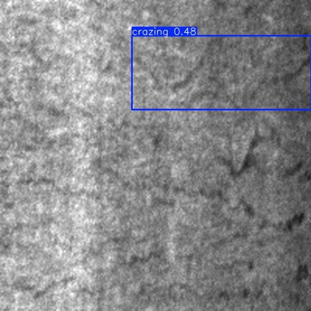
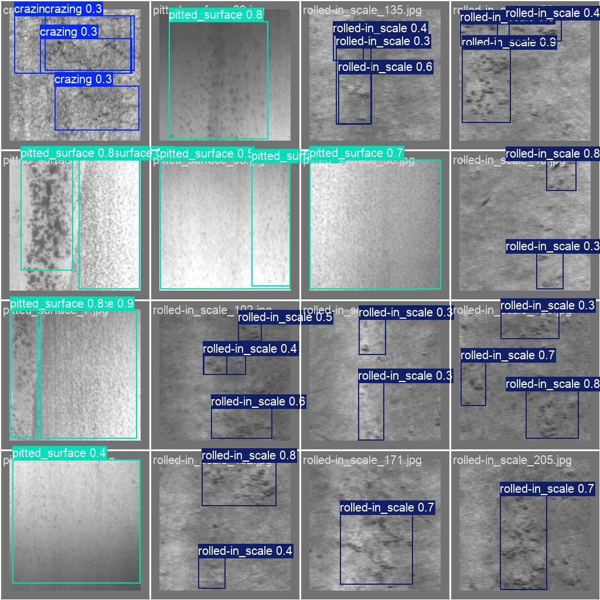
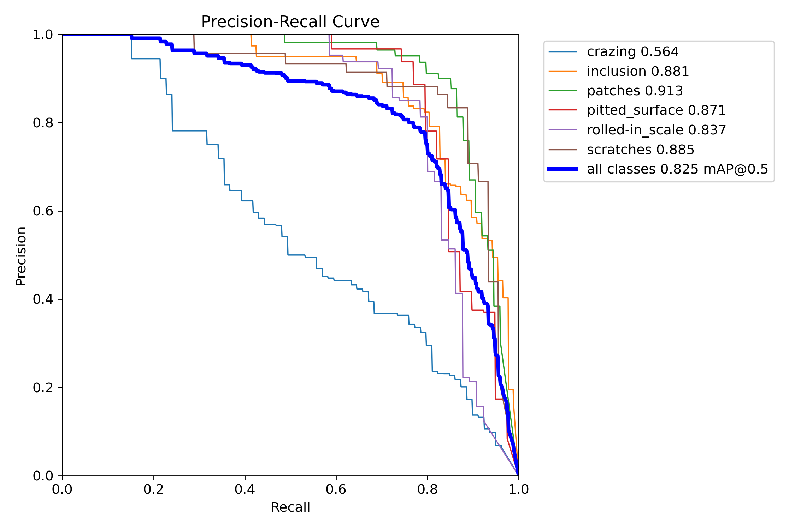

# LuOzawa

**AI Agent Engineer · AI Product Manager · FDE (Forward Deployed Engineer)**

Guangzhou, China · 23

[Email](mailto:linlin700573@gmail.com)

---

## 说明 · Availability

本页列出的仓库中，以下为**公开可克隆**：`kip-agent` · `pf-mdd-yolov8-defect-detection` ·
`study-material-recommender` · `family-finance-tracker` · `gz-student-rental-recsys` · `shiji-releases`。
其余为私有仓库（毕业设计 / 在研产品），可提供**只读访问**，请邮件联系。

**工程习惯**：每个仓库都有 GitHub Actions CI（后端测试 + 前端构建）、MIT License、`v1.0.0` 定稿 tag，
以及精确锁定的依赖版本；44 个自动化测试集中在鉴权越权、token 失效、图像切块覆盖、异常信息泄露这类真会出事的地方。

---

## 精选项目 · Featured

### 🎓 本科毕业设计 · 钢材表面缺陷检测系统（私有）

面向工业钢材表面缺陷检测的完整系统：YOLOv8 骨干 + **SE 通道注意力**，NEU-DET 六类缺陷，
含训练 / 评估 / 推理 / PyQt5 界面全流程，已通过答辩。

| 指标 | 基线 YOLOv8s | YOLOv8s + SE | 提升 |
|---|---|---|---|
| mAP@0.5 | 0.8107 | **0.8291** | **+1.8 pt** |
| mAP@0.5:0.95 | 0.4971 | **0.5153** | **+1.8 pt** |
| 参数量 | 11.17 M | 11.19 M | +32 KB（+0.2%） |

**改进点**：在骨干 SPPF 之后插入 SE 模块（reduction=16，512→32→512），做通道重标定；
新增参数仅 32 KB，几乎零成本换来 1.8 个点的提升。跨设备复现差异 0.3 pt。

| 检测结果（裂纹） | 验证集批量预测 | PR 曲线 |
|---|---|---|
|  |  |  |

> 🔒 该仓库（代码 + 训练权重 + 实验记录）为**私有毕业设计成果**，如需查阅或使用请联系
> [邮箱](mailto:linlin700573@gmail.com)；未经许可请勿复制或用于课程 / 竞赛。

### 🥇 [kip-agent](https://github.com/LuOzawa/kip-agent)

桌面 AI Agent，面向个人编码与企业工作流。仓库带完整工程实践：PR 流程、CODEOWNERS、CI、conventions 文档，技能（skills）体系与沙箱执行。
`TypeScript` · `AI Agent` · `LLM` · `Skills` · `Sandbox`

### 🥈 [pf-mdd-yolov8-defect-detection](https://github.com/LuOzawa/pf-mdd-yolov8-defect-detection)  · PUBLIC(https://github.com/LuOzawa/pf-mdd-yolov8-defect-detection)

塑料薄膜多类表面缺陷检测。YOLOv8 + 宽幅图切块策略，12 类缺陷、4096×256 线扫图像，含数据流水线、滑窗推理融合与类别稳定性评估。
**9 个单测锁住切块策略**（全幅覆盖无空隙、YOLO 框跨块映射、越界框丢弃、结果确定性），依赖精确锁定。
`Python` · `PyTorch` · `YOLOv8` · `Computer Vision` · `Industrial Inspection`

### 🥉 [study-material-recommender](https://github.com/LuOzawa/study-material-recommender)

基于 Hadoop 的考研参考资料推荐系统，融合 UserCF / ItemCF / SVD / TF-IDF 四路推荐，HDFS 归档大规模资料。
**10 个单测覆盖 JWT 鉴权链路**（他人 token 越权拒绝、过期/篡改拒绝、弱密钥启动即失败）。
`Spring Boot 3` · `Vue 3` · `Hadoop` · `HDFS` · `Recommendation`

### 🏅 [family-finance-tracker](https://github.com/LuOzawa/family-finance-tracker)

家庭理财记账系统，KMeans 消费聚类 + ARIMA 支出预测 + 四维财务健康评分，算法与业务结合最紧的一个项目。
**44 个测试**（29 接口 + 15 纯函数），覆盖 ARIMA 三级降级与健康评分边界。
`Flask` · `Vue 3` · `scikit-learn` · `statsmodels` · `Data Visualization`

---

## 技术栈矩阵 · Tech Stack Matrix

| 项目 | 定位 | 后端 | 前端 | 数据 / 算法 | 关键能力 |
|---|---|---|---|---|---|
| [kip-agent](https://github.com/LuOzawa/kip-agent) | 桌面 AI Agent | — | TypeScript | LLM 调用 | 技能体系 / 沙箱 / CI |
| [pf-mdd-yolov8-defect-detection](https://github.com/LuOzawa/pf-mdd-yolov8-defect-detection) | 工业缺陷检测 | — | — | PyTorch · YOLOv8 | 切块 · 滑窗推理融合 |
| `boss-zhipin-data-analysis` | 招聘数据洞察 | Django | ECharts | scikit-learn · jieba | 采集 · KMeans · 回归 |
| [family-finance-tracker](https://github.com/LuOzawa/family-finance-tracker) | 家庭理财 | Flask | Vue 3 | ARIMA · KMeans | 时序预测 · 健康评分 |
| [study-material-recommender](https://github.com/LuOzawa/study-material-recommender) | 考研资料推荐 | Spring Boot 3 | Vue 3 | Hadoop · HDFS · SVD | 四路融合推荐 |
| [gz-student-rental-recsys](https://github.com/LuOzawa/gz-student-rental-recsys) | 租房推荐 | Spring Boot 3 | Vue 3 | 协同过滤 · 余弦相似度 | 推荐 + 地图 · Redis |
| `shop-platform` | 电商平台 | Spring Boot 2.7 | Vue 3 | — | 订单 / 支付 / 优惠券 |
| `pharmacy-management` | 药店管理 | Spring Boot 3 | Vue 3 | — | 库存预警 · 会员积分 |
| `traffic-repair-platform` | 交通设施报修 | Spring Boot 3 | Vue 3 | — | RBAC 工单流转 |
| `community-suggestion-box` | 社区意见箱 | Spring Boot 2.7 | Vue 3 | — | 三端权限隔离 |
| `elder-health-management` | 老年健康管理 | Spring Boot 3.2 | Vue 3 | ADL-MMSE 量表 | 慢病随访 · 预约挂号 |
| `pet-center-management` | 宠物服务中心 | Spring Boot 2.7 | Vue 3 | — | Sa-Token 三端 · 寄养 |
| `liupanshui-tourism` | 文旅门户 | Spring Boot 3.2 | Vue 3 | — | 游客端 15 + 后台 13 模块 |
| `jiufeng-park-management` | 森林公园运营 | Spring Boot 3.3 | Vue 3 | 阈值告警 | 购票 · 预约 · 生态监测 |
| `physical-fitness-test-system` | 高校体测 | Spring Boot 3.4 | Vue 3 | — | 成绩统计 · 导出 |
| `internship-management-system` | 实习全流程 | Spring Boot 3 | Vue 3 | — | 双导师审批 · 周报 |
| `ai-tutor-miniapp` | AI 助教小程序 | Spring Boot 3 | uni-app | DeepSeek LLM | 微信登录 · 错题本 |
| `shiji-website` | 产品官网 | — | Vite · JS | — | Cloudflare Workers 部署 |
| [shiji-releases](https://github.com/LuOzawa/shiji-releases) | 版本分发 | — | — | — | Mac 安装包分发 |

---

## 能力分布 · By Capability

| 方向 | 项目 |
|---|---|
| **AI / Agent** | kip-agent · ai-tutor-miniapp |
| **计算机视觉** | pf-mdd-yolov8-defect-detection |
| **推荐系统** | study-material-recommender · gz-student-rental-recsys |
| **数据分析 / 预测** | boss-zhipin-data-analysis · family-finance-tracker |
| **企业级全栈（Spring Boot + Vue 3）** | shop-platform · pharmacy-management · traffic-repair-platform · community-suggestion-box · elder-health-management · pet-center-management · liupanshui-tourism · jiufeng-park-management · physical-fitness-test-system · internship-management-system |
| **产品工程** | shiji-website · shiji-releases |

---

## 技术标签 · Stack Index

**后端** `Spring Boot 2.7 / 3.x` `Spring Security 6` `Sa-Token` `MyBatis-Plus` `Flask` `Django` `Node.js`
**前端** `Vue 3` `Element Plus` `Pinia` `Vite` `uni-app` `微信公众号小程序` `ECharts` `TypeScript`
**数据 / 存储** `MySQL` `Redis` `HDFS / Hadoop` `SQLAlchemy` `Pandas`
**算法** `YOLOv8` `PyTorch` `scikit-learn` `ARIMA` `KMeans` `UserCF / ItemCF` `SVD` `TF-IDF`
**工程 / 交付** `Docker` `Cloudflare Workers` `GitHub Actions` `Playwright`

*每个仓库都有完整的 README、技术说明与运行指引。*

